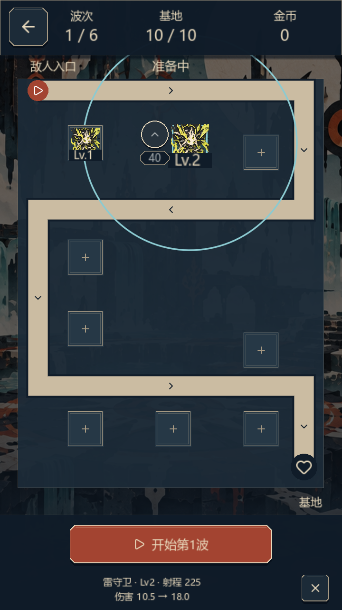
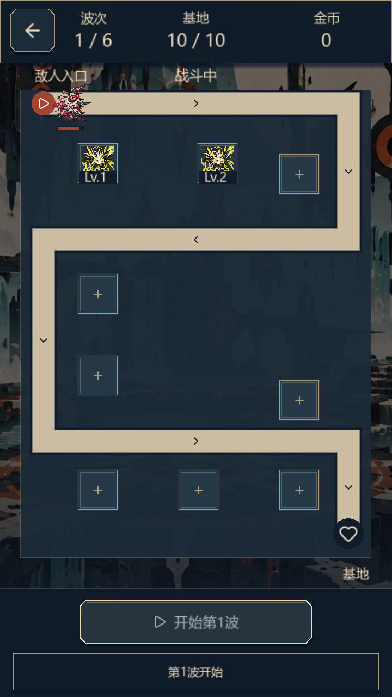
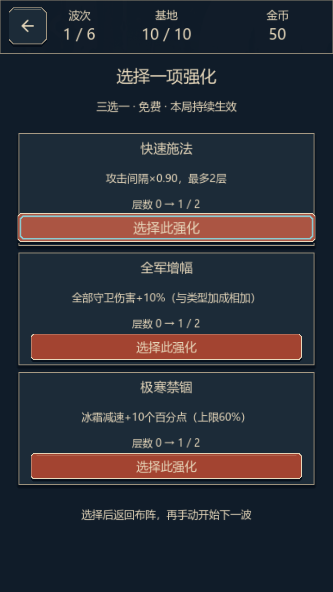

# 元素守卫 · Element Guardians

**一个用可玩原型展示系统、数值与关卡策划思路的竖屏塔防项目。**

你要用有限金币，在道路沿线安排火、冰、雷三类守卫，抵挡六波敌人。召唤结果带有随机性，但放在哪里、什么时候升级、波间选择哪张强化卡，由玩家决定。

本项目面向游戏策划求职与作品展示：重点是把“设计意图 → 规则 → 数据 → 可玩反馈 → 验证与迭代”连起来。目前已有六波与波间强化流程的自动化验证，仍在进行体验打磨；没有商业化或真人完整验收结论。

| 类型 | 平台 / 操作 | 技术 | 当前规模 |
|---|---|---|---|
| 单机2D塔防 · 局内随机强化 | Windows · 鼠标点击 | Godot 4.4.1 / GDScript / Excel→CSV | 3类守卫、4类敌人、6波、6张强化卡 |

## 先看游戏实际运行画面

以下图片来自**当前 Godot 4.4.1 玩家场景实际运行**，由自动化输入完成召唤、金币升级和开波后取图；不是概念设计稿，也不代表真人试玩验收。截图说明与复现来源见[截图记录](docs/images/README.md)。

<table>
<tr><th>沿路布防与原位升级</th><th>自动战斗与真实攻击反馈</th><th>波间三选一强化</th></tr>
<tr>
<td></td>
<td></td>
<td></td>
</tr>
</table>

[查看普通、迅捷与重甲敌人的动态检查记录](docs/images/enemy-motion.webp) · 放大区为显示检查夹具，包含测试敌人，不冒充自然对局。

## 不懂塔防，也能这样玩

1. **准备**：开局60金币、基地10HP。点道路旁空塔位，花20金币随机召唤一名守卫。
2. **布防**：查看射程，把火力安排在敌人经过的路段；点已有守卫，可花金币原位升级，最高Lv3。
3. **开波**：确认布局后开始战斗，守卫自动攻击。战斗中可查看信息，不能召唤或升级。
4. **应变**：第1—5波结束后，从三张不重复的强化卡中选一张，再回到准备阶段。
5. **结算**：完成第6波时基地仍有生命即可获胜；基地HP归零立即失败。第6波包含且仅包含一个Boss。

当前玩家地图为**9处沿路塔位**，不是中央九宫格，也不是永久数量上限。原先被标记的额外出口塔位已删除。旧九格/固定三塔地图仅作为独立诊断基线保留。

## 这个项目想解决哪些策划问题

### 1. 给玩家可控的决策，保留随机带来的变化

召唤按火/冰/雷 **4∶3∶3** 抽取元素，玩家主动决定落点。随机性影响阵容，位置决定它实际承担哪一段防守职责。

火焰偏单体输出，冰霜负责减速，雷电负责连锁。它们通过攻击节奏、射程、控制与群体收益形成差异，而非只换颜色。

| 守卫 | Lv1伤害 / 间隔 | 基础射程 | 设计用途 |
|---|---:|---:|---|
| 火焰 | 12 / 1秒 | 230 | 提供直接单体火力 |
| 冰霜 | 8 / 1.2秒 | 235 | 基础20%减速、持续1.5秒，延长火力覆盖时间 |
| 雷电 | 6 / 0.8秒 | 225 | 额外连锁1个目标，副目标伤害为50% |

这些是原型当前值，不是已平衡的结论。单目标静态DPS无法独自衡量减速、连锁与漏怪，需结合具体波次观察。

### 2. 用更清楚的成长规则，降低操作理解成本

项目从早期合成方案改为**金币原位升级**：Lv1→Lv2花20，Lv2→Lv3花40；保留元素、位置和塔数，升级不重抽、不扩大射程。消费只发生在明确的升级按钮上，选中或查看免费。

这让玩家能直接比较“补一个位置”与“加强现有火力”，并减少合成带来的单位消失与布局变化。伤害倍率当前为 **1 / 1.75 / 3**。例如火焰守卫升至Lv2，单目标静态DPS从12升至21，射程仍为230；最终收益仍取决于敌人是否处于攻击范围内。

20/40是委托AI提出并落地的首版试验费用，尚未完成经济与难度平衡验收。[查看成长规则决策](tracking/DECISIONS.md)

### 3. 按道路职责布置塔位，而不是只追求几何覆盖

沿路位置分别承担入口削血、折返支援、下行防守与末端防守。判断一个位置是否有价值，需要看实际选敌、冷却、命中与漏怪，不能只看射程圆是否碰到道路。

当前已保留真实攻击、出口前击杀以及五个seed、两种布防顺序的六波回放。自然模拟仍主要在前段清怪，后段压力与塔位必要性尚需真人体验和数值迭代。[查看布局与验证说明](docs/maps/D015-ROADSIDE-LAYOUT.md)

### 4. 让界面服务战场决策

根据反馈，升级交互从占据战场的属性外框改为**塔旁单个图标＋直接价格**，详细属性复用底部文字区；边角按钮向内展开，保留完整点击区。

同时检查720×1280与540×960下的遮挡、文字和操作范围。召唤、升级、攻击、受击、金币与HP变化绑定真实事件；普通蛛机、重甲蛛机和漂浮敌人采用各自的移动表现。

## 怎样证明设计有落地

- **单一数值来源**：[主配置表](configs/ElementGuardians_策划数值配置.xlsx)维护守卫、敌人、波次、强化和经济；同步生成两份CSV，避免策划表与运行数据各说各话。
- **可复现随机性**：支持显式seed，召唤与强化使用独立随机流，候选和选择可记录、可回放。
- **规则边界可检查**：金币不足不扣款、战斗禁止布阵、重复消费拒绝、Boss唯一、胜败互斥、满层强化不入池等都有对应验证。
- **保留失败再复盘**：测试红日志与历史报告不改写；自动逻辑、真实渲染、真人体验和性能验收分开记录。

最近动画/删位切片：定向21项通过，原红蛛29项回归通过；720/540连续图形各372项通过，塔旁六语言检查各569项通过。现有完整检查组为**22 PASS / 2 FAIL**：历史MANIFEST两项哈希失配，以及音频快速点击断言失败。音频单独诊断通过，但原失败根因未确认；headless内部仍有真实渲染SKIP。

这些证据说明对应检查执行过，**不等于真人完整流程、平衡、听感、母语审校、低端性能或EXE交付通过**。原始日志按要求仅本地保留，GitHub提供摘要、截图与复现脚本。[最新验证报告](logs/test_runs/20261025_enemy_motion_fix/REPORT.md)

## 我的工作与AI协作边界

**本人负责的策划裁决与反馈**包括：项目定位与范围、成长方式改为金币升级、沿路布防方向、删除多余塔位、塔旁紧凑升级入口、竖屏空间优先级，以及不同敌人应有符合形态的移动反馈。

**AI辅助**包括：方案建议、GDScript与测试实现、配置工具、显示与动画、截图取证及文档整理。未由本人审阅或实际验收的内容，不包装为独立完成或已验证成果。

这份作品希望展示的是：能提出清楚的问题，做出可解释的取舍，把规则交给实现，并依据真实反馈继续修正。[贡献与作品集说明](docs/13-PORTFOLIO.md)

## 下载后怎么运行

需要 **Godot 4.4.1标准版**，当前没有可直接分发、已验收的EXE。

- **通用方式**：用Godot导入`godot/project.godot`，运行主场景；或执行：

```powershell
& "你的Godot4.4.1路径/Godot_v4.4.1-stable_win64_console.exe" --path godot -- --player-seed=42
```

- **本机快捷方式**：双击`启动游戏.cmd`。该脚本目前绑定`E:/godot/Godot_v4.4.1-stable_win64_console.exe`；其他电脑请修改其中`EG_GODOT`路径。
- **开发检查**：Python配置工具无需新增第三方依赖。

```powershell
python tools/sync_config.py --check
python tools/validate_config.py
```

完整引擎验证与图形检查命令见[Godot运行说明](godot/README.md)。资源来源与授权记录见[素材规范](docs/07-ASSETS.md)。

## 继续了解策划过程

| 想看什么 | 对应材料 |
|---|---|
| 现行规则与取舍依据 | [系统规格](docs/02-SYSTEM-SPEC.md) · [决策记录](tracking/DECISIONS.md) |
| 数值设计与试算方法 | [数值设计](docs/03-BALANCE.md) · [字段定义](configs/SCHEMA.md) |
| 六波内容与关卡思路 | [关卡与敌人](docs/04-LEVELS.md) |
| 验收方法与真人试玩计划 | [测试计划](docs/08-TEST-PLAN.md) · [试玩协议](docs/18-PLAYTEST-PROTOCOL.md) |
| 当前进度与后续范围 | [路线图](docs/09-ROADMAP.md) · [最新交接](NEXT_SESSION_PROMPT.md) |

部分早期文档保留九格/合成等历史版本；现行规则以AGENTS、决策记录的最新补充及实际代码为准。Boss演出、后续不同道路和无限模式仍待独立设计，未包含在当前完成状态中。
