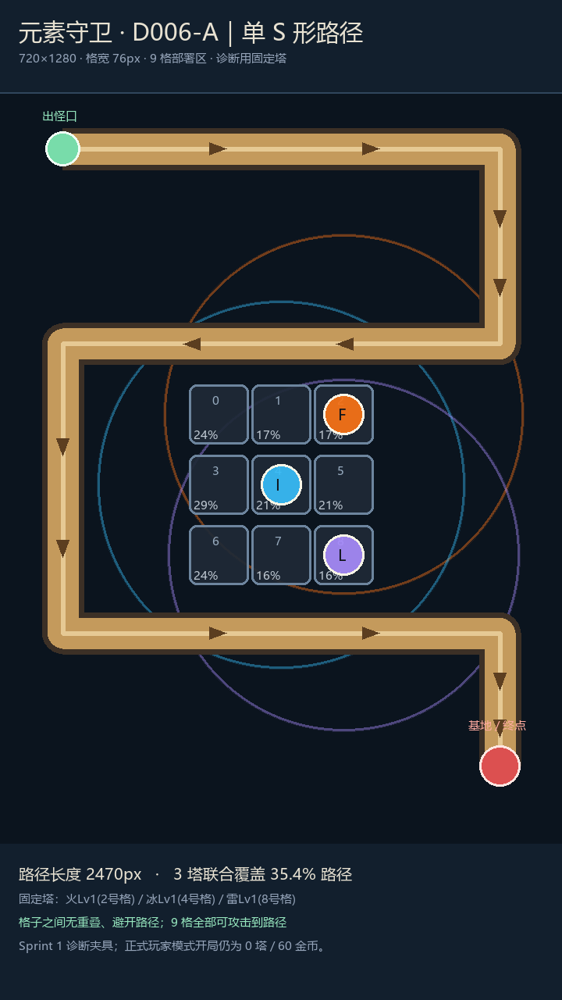

# D006 地图与诊断夹具确认记录

状态：**2026-10-20 用户已确认并应用**。

用户原话：“采用 76px 格宽，三塔统一为当前实际 Lv1（推荐）”。

## 已采用的最小差异

| 项目 | 原草稿 | 确认后 | 影响 |
|---|---|---|---|
| 同行相邻格中心距 | 80px | 80px | 不移动守卫位置 |
| 格宽 | 84px | 76px | 4px 重叠变为 4px 间隔 |
| 行间中心距 | 90px | 90px | 行间间隔从 6px 变为 14px |
| 路径长度 | 2470px | 2470px | 不改变行进距离 |
| 固定三塔 | JSON 写 Lv2，实际丢失等级后为 Lv1 | 配置与运行时统一 Lv1 | 保持此前实际难度 |
| 射程与九格中心 | 现有值 | 不变 | 联合覆盖仍为约 35.4% |

固定位置为火 2、冰 4、雷 8。仅诊断模式使用。正式玩家开局仍为 0 塔、60 金币；XLSX/CSV 无变动。

原预览保留作历史草稿；新图已修正固定塔位置与等级的标注。示意图不是游戏实机截图。

## 验证结果与限制

- 地图运行时断言：5 PASS / 0 FAIL；Python 几何校验：2 PASS / 0 FAIL。
- 三塔基线：seed=20261018，dt=0.05s；只自动推进诊断波次，无召唤/强化、无强制击杀、无伤害覆盖。
- 第4波四只重甲漏过，HP 从10变2；第5波失败。总生成47、击杀41、漏怪5、失败时清理1；模拟战斗时间161.55秒。
- 六波通关门槛未达成。不能把已修复程序错误或地图通过写成 Sprint 1 完成，也不能把该诊断结果当作真人局长或通关率。
- 后续需要用户裁决诊断布阵/成长方案；未批准提高等级或改变数值，未接入正式战斗页面。

决策见 tracking/DECISIONS.md 的 D006/D007，原始证据位于 logs/test_runs/20261020_s1-repair。
