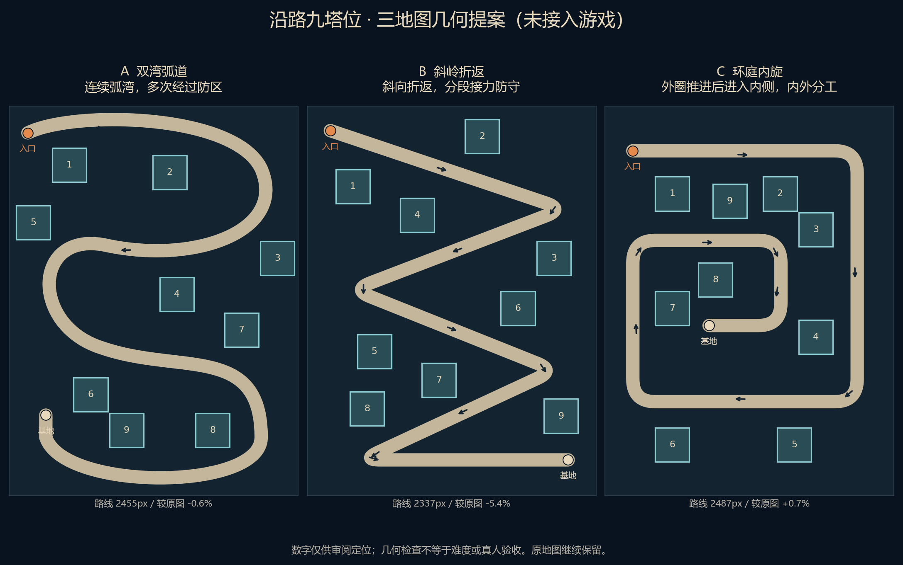

# 2026-10-23｜就近召唤、可选教程与沿路九塔位提案

状态：**设计提案，未接入Godot；地图具体几何待用户审阅**。本目录是新增设计材料，不覆盖旧地图、玩法配置或历史证据。

## 1. 本轮目标与用户确认

- 点空位后，直接在该位置附近显示攻击范围与召唤操作，不再移到底部点召唤。
- 用户明确答复：**仍然随机召唤，弹出面板只展示类型说明**。保留火/冰/雷4/3/3、20金币召唤、初始60金币/10HP、同类同级最高Lv3。
- 教程只从设置主动进入，第一波不强制出现教程。
- 用户明确答复：**每局使用一张固定地图，下一局可换地图；同局6波不换路**。
- 用户提出九个塔位分散到道路两侧的方向；具体路线和塔位仍须审阅，不能直接把草图视为已批准的新默认难度。

## 2. 布阵交互

| 状态或操作 | 拟议行为 | 边界与反馈 |
|---|---|---|
| 点空位 | 高亮目标，显示射程预览，就近弹出纸层操作面板 | 面板优先在目标上方，越界时换下方或侧面；不能放在屏幕顶部迫使远距离移动 |
| 随机结果尚未知 | 展示火40%/冰30%/雷30%，说明各自特点 | 三张类型说明不承担购买动作，不能让玩家误以为可指定类型 |
| 射程预览 | 显示225–235px预览带；说明火230/冰235/雷225 | 不能用某一类型的射程冒充最终结果；配置是数据来源，不在UI另设数值 |
| 点击“随机召唤 · 20” | 在当前空位执行一次原有随机召唤 | 扣费与生成原子处理；快速重复点击不能重复扣费或抽随机数 |
| 召唤成功 | 关闭空位面板，显示实际守卫与精确射程 | 金币/单位立即更新，出现动画不拦操作；不改变玩法计时 |
| 点空白、同一空位或Esc | 关闭面板和预览 | 不扣钱，不抽随机数；点另一空位则切换锚点 |
| 金币不足 | 保留说明，购买按钮禁用并显示原因 | 不能只变灰；不扣钱，不抽随机数 |
| 点已有守卫 | 查看类型、等级、特性和实际射程，提示可合成对象 | 保留先源后目标的合成规则；明确源消失、目标保留升级，失败不改变状态 |
| 战斗中 | 只读查看守卫信息；召唤和合成不可操作 | 不以信息面板代替暂停，不暗中冻结战斗时间 |
| 开波 | 底部保留明显的“开始第n波”和阶段信息 | 始终玩家主动触发；空盘允许开波规则不改，拟加一次明确提醒与继续选项 |

底部移除常驻召唤按钮；局部面板需要保证720×1280与540×960可点、六语言可读，鼠标/键盘能取消并恢复焦点。继续复用已审阅按钮动效，保持实体不透明面板和玩家动画始终开启，不新增动画开关。实现时实际验证连续点击、取消、开波切换、目标消失和动效清理；本轮未实现这些行为。

## 3. 设置中的玩法教程

- 设置标题拟改为“设置”，保留六语言/声音，新增“玩法教程”。入口命名清楚，不叫“设置教程”。
- 主动打开独立教程页面：守护基地 → 随机召唤与射程 → 同类同级合成 → 手动开波与波后流程。关闭后返回设置，保留语言/声音和焦点。
- 首版采用分页图文和明确标注“教程演示”的短动画；不把静态截图称作已验证动效，不伪造真实对局事件，不消耗对局金币或随机流。
- 教程文案要说明当前开发版只接首波，后续强化/完整六波未完成；正式接通后再同步文案。第一波不自动弹教程、不强制走教学、不赠送教学资源。
- 本轮不将设置强行接到战斗里：当前没有战斗暂停，新增入口若需要跨战斗访问，应另明确是否只读或暂停，不能打开弹层后让基地在遮挡下继续失血。

## 4. 三张沿路地图草图

| 提案 | 路线形态 | 长度 | 对比原2470px | 九塔位方向 |
|---|---|---:|---:|---|
| A 双湾弧道 | 弧湾折返并从底部绕回 | 2455.4px | -0.6% | 分散在弯道内外，沿程有前中后段位置 |
| B 斜岭折返 | 斜向折返，底部进入基地 | 2337.3px | -5.4% | 斜坡两侧分布，强调不同路段的接力覆盖 |
| C 环庭内旋 | 先绕外圈再进入内侧基地 | 2486.7px | +0.7% | 外圈、内侧和终点区域各有位置 |

- 保留总共9个、每个76px的固定塔位，但不再强制排成屏幕中央3×3方阵。这是布局规则变更方向，尚未更新AGENTS、规格、生产JSON或旧断言。
- 当前三图每个塔位对火/冰/雷都有正的路径覆盖，塔位互不重叠，完整76px正方形对40px道路保守净距均超过12px。详见`maps.json`，每个位置记录三种射程覆盖的路径长度；覆盖有交叠，不能直接相加当作总覆盖。
- 这些指标只证明本提案的基本几何，不证明路线清晰、逐格平衡、六波可通关或真人体验。没有用升塔、改伤害、改敌人或降低验收标准消除风险。
- 图中数字仅供审阅定位，正式玩家界面不放调试格号。箭头、入口和基地均需在游戏中保持可辨识。
- `maps.json`仅是方案数据，不符合或替代生产地图schema。A曲线已采样；运行时接入仍须验证采样长度/拐弯、目标选择及边界时序。
- D006/D008原地图和所有历史红绿基线保留，不重写其坐标、夹具或测试使新图通过。

## 5. 每局选图、种子与启动方式

- 每局只在开局选择一次地图并记录seed/map_id，同局六波固定。地图选择与召唤、强化使用独立随机流。
- 同seed必须能复现同图和相同操作结果；不同局随机选图允许偶然重复，不擅自增加“绝不重复”规则。
- **当前启动器固定seed=42，重开也复用seed，因此不能直接沿用它来声称每次会换图。** 接地图时应让正常“新一局”生成并记录新seed；固定seed=42保留为显式复现入口。本轮没有修改启动器。
- “重新挑战本局”与“开始新一局”应区分：前者保留seed/map，后者新seed重新选图；都重置本局金币/HP，不做跨局成长。

## 6. 拟议实施切片与验收

1. 先实现原地图上的就近随机召唤面板、准确射程预览，以及设置→玩法教程。只改交互，不同时改地图/数值；逻辑保证失败不扣钱、不消耗随机数。
2. 审阅三张地图的具体路线/九位置，记录新的布局决策后接入。校验各图正方形塔位不压路、不重叠、实际射程吻合、地图RNG独立和seed回放；保留原诊断地图测试。
3. 随后完成强化三选一与玩家六波/结算；对每张新图记录真实生成/击杀/漏怪/Boss/HP/金币/时间，再由用户做体验验收。当前首波边界不能伪装成完整游戏。

UI实现拟涉及`battle_view.gd`、`player_field.gd`、新增局部操作面板/教程脚本、`player_settings_panel.gd`、`ui_locales.json`和对应输入/多语言测试。地图接入另涉及新地图数据、加载/选择职责和几何/回放测试；本轮未改这些生产文件。

## 7. 本轮执行、证据与限制

- 已读取规则/README/导航/路线图/决策/最新交接，以及实际设置、选位、召唤、地图代码；应用`game-ui-design`的就近操作、状态完整性、反馈、取消与本地化检查方法。
- 命令：`python -B tools/validate_config.py`，配置校验1 PASS；Godot `--version`确认为`4.4.1.stable.official.49a5bc7b6`。这两项输出仅在本轮工具记录，未另存原始日志。
- 命令：`python -X utf8 -B output/visuals/proposals/20261023-local-summon/build_proposal.py`，生成地图/图片/HTML；几何3 PASS / 0 FAIL / 0 SKIP，结果和保护文件哈希在`maps.json`。原XLSX、生产地图、塔CSV、玩家召唤脚本前后SHA256相同。
- 地图PNG已实际查看；HTML仅生成，**交互未实测**。内置浏览器拒绝`file://`协议，用户授权后该工具限制仍在；未改地址、起服务或换浏览器绕过。
- 本轮没有打开Godot GUI，没有实现新交互或跑战斗回归；未实机验收、无新动效/性能/六波证据。P1完整流程/历史崩溃、P2历史MANIFEST红项仍在。
- 新增文件只在本目录；原启动器、README、CHANGELOG、MANIFEST的上一轮未提交修改保留。本轮不提交、不推送，HEAD仍为master / `646bfa22f6499bc23e2ba694c41343af6397f547`。
- 下一步：审阅地图具体几何，优先落地就近召唤与可选教程切片；这份方案不表示地图或完整游戏已通过。
