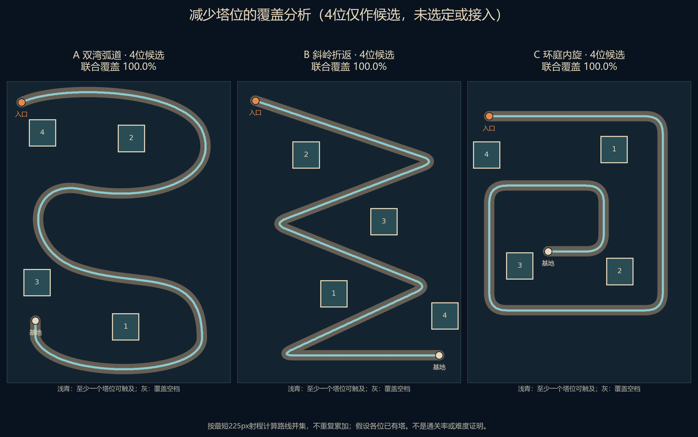

# 2026-10-23｜少量高价值塔位与随机守卫射程

状态：**设计分析，未接入游戏**。本记录修正上一份提案机械保留九格的建议；不覆盖旧图或把新数量写成已批准规则。

## 1. 设计结论

用户希望用少量塔位覆盖更多路线，并通过布阵产生挑战。建议：**实际攻击范围属于守卫；塔位只提供位置；关卡设计按最短守卫射程评价格位。** 不把射程永久绑定在格子上，也不通过格子隐性增减守卫射程。

当前生产配置：雷225px、火230px、冰235px。这三个数值本轮不改。同一格随机得到不同守卫，实际范围允许不同；但格位设计不能要求必须抽到某一元素才能发挥基本作用。元素差异先由现有单体伤害、减速、连锁表达，不为突出元素差异临时更改射程。

## 2. 玩家能理解的预览

| 时点 | 应显示什么 |
|---|---|
| 点击空位，尚未召唤 | 以该位置为圆心显示225px保证范围及225–235px可能范围带；说明“实际范围取决于随机守卫” |
| 查看类型说明 | 明确火40%/230px、冰30%/235px、雷30%/225px；说明卡不负责自选或购买 |
| 随机召唤成功 | 收起范围带，仅显示实际守卫精确射程，单位/金币与真实结果同步 |
| 点已建守卫 | 查看其类型、等级、范围和合法合成目标；取消后隐藏范围 |
| 合成完成 | 显示目标守卫实际属性；当前升级只改变伤害，不得画成射程也升级 |
| 战斗阶段 | 范围查看只读，不允许召唤/合成，不因打开查看面板暂停时间 |

射程展示使用同一世界坐标和生产属性，不按格子边框、角色贴图大小或动画缩放计算。面板就近出现，实体底、点击区稳定；实际动效和输入待实现后验证。本轮只是设计，不声称已有以上界面。

## 3. 计算结果：九格不是覆盖所必需

对上一轮三张候选路线重新搜索合法沿路位置，以最短225px射程计算**路线弧长的联合覆盖**，重叠只算一次，不计算没有敌人经过的空地。每个方案都假设展示的塔位已被守卫占用；不是开局60金币已能建满，也不是伤害/击杀/通关率。

| 候选塔位数 | A双湾弧道 | B斜岭折返 | C环庭内旋 |
|---|---:|---:|---:|
| 3 | 90.73% | 92.88% | 94.24% |
| 4 | 100.00% | 100.00% | 100.00% |
| 5–9 | 本次搜索均100% | 本次搜索均100% | 本次搜索均100% |

因此目前已经找到**四位全路线覆盖候选**。继续增加位置不会提高这项覆盖指标，但可能增加同屏火力、交叠集火、合成余地和策略选择；这些价值不能从并集覆盖中直接推断。

搜索采用16px候选网格、约2px路径采样、12个起点的贪心搜索与局部换位，再以线段/圆交区间的精确并集复核。**没有证明连续空间或候选网格的全局最优，也没有证明三位不可能更好**。本次不应宣称“四个绝对最少”或将3位搜索结果视为上限。

三个4位方案都保持76px格宽、不压40px道路、位置间中心距至少112px；这些是本次比较条件，不能替代实际UI可点性和玩法验收。详细坐标、每档数量、覆盖区间/空档、保护文件SHA256见`slot-count-analysis.json`。

## 4. 挑战来源与必须处理的满位风险

- 不再按“每图必须九格”设计；先寻找少量能覆盖不同路段、弯道和补漏区的位置。四位可作为几何原型，具体地图不必凑相同数量。
- 有意义的取舍包括：先守前段还是留后段补漏；随机得到减速塔后如何与输出塔配合；立即合成还是保留两个攻击点。当前不添加战斗中操作或手动技能，准备阶段操作边界不变。
- 并集100%不代表每段有足够攻击次数，更不代表减速、连锁和Boss处理有效。实际候选还要检查首次攻击时机、各段交叠火力、空档、出口补漏和被合成后覆盖变化。
- **仅减少格子可能造成操作卡住。** 三格初始抽到火/冰/雷各一只的概率为6×0.4×0.3×0.3=21.6%；满位且无合法合成。四格也存在满位无合成状态，例如火Lv1、火Lv2、冰Lv1、雷Lv1（共需5次召唤和一次火合成，存在可达操作序列）。五、六格只是推迟这类问题，并非自动解决。
- 在保持随机召唤、无出售/退款、最高Lv3的前提下，不能把满位导致无法继续召唤称作挑战设计。故**暂不推荐直接把生产九格强改四格上线**。
- 设计选择需要用户裁决：可以评估“少量战斗塔位＋独立合成/待命机制”，或“PREP允许有代价地腾换单位”；两者都是新玩法，本文不擅自加入，也不暗中改成自选元素。新增待命位本身亦不自动保证永远不卡，仍需完整随机状态验证。
- 若坚持原规则完全不加满位处理，就必须把4/5/6位的可达满位状态与六波策略一起测试，再定数量，不能只凭覆盖图选数。

## 5. 实施前的最小比较

1. 先确定“射程归守卫、格位按225px做基础覆盖”的设计原则；沿用现有随机召唤和射程数值。
2. 以四位覆盖候选为起点，比较4/5/6位的实际火力和合成空间；不要一开始重新锁死某个数量。
3. 在满位处理规则裁决后，验证其可达状态、费用/消耗、失败不抽随机数、合成不变量与完整六波。新原型的失败如实保留。
4. 最后接入已提出的就近召唤面板和可选教程，按720×1280、540×960、六语言和真实输入检查。当前Godot仍为首波切片，不算六波通过。

## 6. 本轮交付与证据

- 目标完成：检查了固定九格必要性和射程归属，完成候选数量比较与本设计说明；生产功能未实现。
- 新增文件：`analyze_slot_counts.py`、`slot-count-analysis.json`、`four-pad-comparison.png`、本文件；生成过程中另留`five-pad-comparison.png`，为五位比较图，非最终选定数量。上一份九位草图及原始数据保留。
- 实际玩法/配置字段/数值变动：无。原地图、玩家召唤脚本、主XLSX、塔CSV与上一份方案数据前后SHA256相同，证据在分析JSON。
- 命令：`python -X utf8 -B output/visuals/proposals/20261023-local-summon/analyze_slot_counts.py`。21组（3图×7档）几何/覆盖复核PASS / 0 FAIL / 0 SKIP；这是计算验证，不是游戏测试。另执行配置校验PASS与Godot版本检查4.4.1，输出仅在工具记录。
- 未验证：新塔位实际战斗、完整六波、策略难度、输入/动效、真人体验、低端性能、EXE；未实机验收。脚本没有调用Godot战斗，不得将这些计算数写成玩法PASS。
- 风险：P1随机合成满位问题和完整玩家流程阻断；P1历史崩溃根因未明；P2旧MANIFEST两项历史红。少格策略是否有趣仍无真人证据。
- Git：master / `646bfa22f6499bc23e2ba694c41343af6397f547`，上一轮未提交文件保留；本轮不暂存、不提交、不推送。
- 技能：应用`game-ui-design`，按选位、未知随机结果、已建守卫、合成、满位/缺钱和战斗只读等状态设计展示与反馈；无新UI动效实现。
- 下一步最小建议：先确认射程归属原则与满位处理方向，再试4/5/6位，不直接以覆盖率代替游戏体验裁决。
